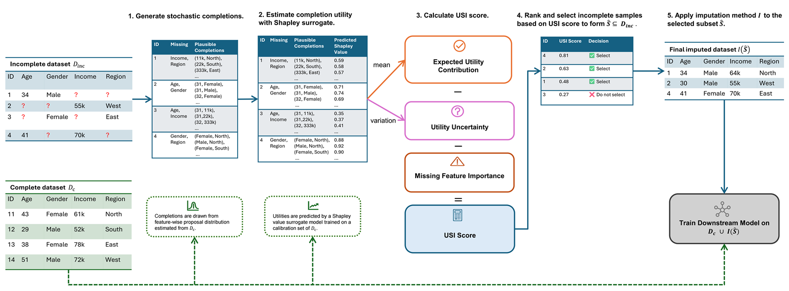

# USI_Utility_Aware_Selective_Imputation

This repository contains the implementation of USI (Utility-Aware Selective Imputation) from the paper "Utility-aware Selective Imputation of Tabular Data for Predictive Analytics".

  

USI addresses learning with incomplete tabular data by selecting which incomplete samples to keep before imputation and training. Instead of blindly imputing all incomplete samples, USI:

- Estimates each incomplete sample's expected task utility via a Shapley-value surrogate over multiple stochastic completions.
- Quantifies utility uncertainty across those completions.
- Penalises missingness in task-relevant features using missing-feature importance.

Samples with high USI scores (high expected utility, low uncertainty, less task-relevant missingness) are selected, imputed, and used with the complete data for model training.

---

### Repository structure (key files)

- `main.ipynb`  
  End-to-end notebook that runs the full USI pipeline on the Adult Income dataset:
  - Data loading and splits (train / develop / validation / test).
  - Evaluation on the fully-observed dataset (upper bound).
  - Simulation of missingness under MCAR / MAR / MNAR.
  - Remove all incomplete rows, evaluate on complete_samples only as lower bound.
  - Shapley-based utility estimation and surrogate model training.
  - USI selection and downstream evaluation with multiple imputers.

- `data_preprocessor.py`  
  Preprocessing utilities for:
  - Encoding categorical features and scaling numerical features.
  - Creating dataset variants (drop all incomplete rows, add missing indicators, calculate per-feature marginals).
  - Interfacing with different imputation plugins.

- `simulate_missingness.py`  
  Functions to simulate missing values under:
  - MCAR, MAR, MNAR with configurable row-missing rate, cell-missing rate, and feature-wise heterogeneity.

- `sv_utility_calculation.py`  
  Shapley-based data valuation:
  - Configures and runs gradient-based Shapley approximation.
  - Trains a surrogate regressor (Random Forest) on complete data to approximate utility.

- `usi_data_selection.py`  
  USI selection logic:
  - Combines expected Shapley utility, utility variance, and missing feature importance into a single score.
  - Selects a specified proportion of incomplete samples for imputation and training.

- `pytorch_models.py`, `pyclassifiers.py`  
  PyTorch models and wrappers:
  - ResNet-style classifier for tabular data.
  - Utilities for training, evaluation, and feature importance estimation (TreeSHAP on Random Forests).

- `utils.py`  
  Helper functions: seeding, saving/loading pickles, misc utilities.

---

### Dependencies

This project uses **Python 3.11+** (see `main.ipynb` metadata) and common ML libraries, including:

- `torch`
- `scikit-learn`
- `pandas`
- `numpy`

and additional packages required by your chosen imputers (e.g. MissForest, MICE, MIWAE, GAIN, HyperImpute, Miracle, SoftImpute, Sinkhorn).

### Data

The code assumes tabular datasets in `dataset/`:

- Example: **Income** — [https://archive.ics.uci.edu/dataset/2/adult](https://archive.ics.uci.edu/dataset/2/adult)
  - Raw file expected at: `dataset/income/raw_data.csv`
  - The notebook splits it into:
    - `dataset/income/train.csv`
    - `dataset/income/develop.csv`
    - `dataset/income/validation.csv`
    - `dataset/income/test.csv`

### Citation

TBC
